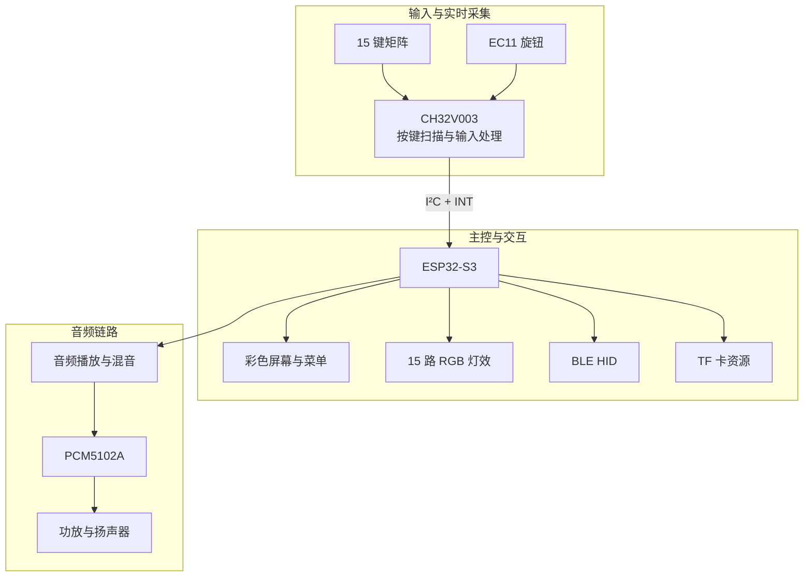

# SKY-music 把游戏音符变成一台真正能弹的便携琴


<!--
【封面图：建议 1200×675 或 16:9】
拍摄完整装机状态，设备占画面主体。
背景采用干净的深蓝渐变或低饱和自然场景，按键 RGB 灯效清晰可见。
避免堆叠大段文字，封面只保留 SKY-music V2 与一句核心标语。
-->

<!--
【演示视频：替换为 B 站或其他公开视频链接】
建议 30–60 秒，包含：

1. 实体按键与 RGB 灯光同步响应
2. 扬声器播放钢琴采样
3. 屏幕、旋钮与曲谱跟练
4. BLE HID 连接游戏
5. 产品外观与内部硬件
-->

## 01 · 认识 SKY-music

SKY-music V2 是一款面向《光·遇》等其他游戏玩家与电子制作爱好者的开源便携电子琴。

在游戏中，15 个音符对应一组熟悉的按键布局。SKY-music 将这组键位做成实体按键，并将发声、灯光、显示、曲谱和无线输入整合进一台独立设备。

按下按键，设备播放对应的钢琴采样，按键灯同步响应。通过屏幕和旋钮，可以操作设备、选择曲谱并进入跟练模式。连接兼容设备后，实体按键还可以通过 BLE HID 发送键盘输入事件。

设备的核心演奏功能运行在本机。开机后即可使用内置音源进行演奏，曲谱、背景与音色资源也有对应的本地存储方案。

**SKY-music 的设计目标，是让游戏中的 15 音演奏拥有实体乐器的操作体验，同时保留一台开源电子设备应有的可复刻性与可扩展性。**

<!-- 【产品主视觉图：建议紧接本节】
建议同时准备一张正面图和一张 45° 角度图。
正面图突出 15 键布局、RGB 灯和显示屏。
45° 图突出外壳厚度、旋钮、接口与整体便携形态。
-->

## 02 · 从按键到完整演奏体验

### 实体按键与发声

15 个实体按键对应 C4 至 C6 的 15 个白键。每个按键对应明确的音高，键位编号与出厂音源、曲谱格式保持一致。

板载钢琴采样为设备提供独立发声能力。出厂音源存放在本地 Flash 资源区，基础演奏不依赖 TF 卡。

<!-- 【实拍图：手指按键与灯光亮起】
建议拍摄一张近景，能够同时看到按键、灯光和手指。
-->

### RGB 灯光反馈

每颗按键配备独立 RGB 灯光，用于按键反馈和曲谱跟练提示。

灯光与实体键位直接对应，使演奏提示落在实际操作位置上。对于刚接触曲谱或仍在熟悉键位的用户，这种设计可以降低视觉查找与手指定位的负担。

<!-- 【动图：连续按键，灯光同步变化】
GIF 控制在 5–10 秒，优先展示真实响应。
如果支持目标音符提示，另放一段跟练动图。
-->

### 彩色屏幕与旋钮

板载彩色屏幕承担菜单、曲谱和视觉资源的显示，旋钮用于菜单选择与交互。

界面围绕设备的演奏任务设计，让用户可以在本机完成主要操作。屏幕采用 284 × 240 分辨率，配合专门制作的背景资源，形成与 SKY-music 定位一致的视觉风格。

<!-- 【界面截图组：建议 3 张并排】
1. 主界面
2. 曲谱或跟练界面
3. 音乐播放或资源选择界面

请使用真实固件截图；如果某个界面尚未完成，不要放入正式展示图。
-->

### 曲谱跟练

设备提供曲谱选择与跟练功能，结合按键灯光提示演奏目标。

<!-- 【跟练功能实拍或录屏】
建议完整展示一次曲谱加载、目标按键提示、正确输入及错误输入后的行为。
如果当前固件支持错误输入拦截，可在视频中明确展示。
-->

### BLE HID 游戏输入

SKY-music 支持 BLE HID 键盘输入。配对后，兼容的手机、电脑或游戏环境可以接收设备发送的按键事件。

对于《光·遇》等采用对应键盘映射的演奏场景，用户可以通过实体按键进行输入，减少持续触摸屏幕带来的操作负担。

具体兼容性取决于目标系统、游戏版本及其键位配置。

<!-- 【实拍图或视频：设备连接电脑 / 游戏】
建议同时展示实体按键与屏幕中的实际游戏反馈。
如有延迟测试，可在后续技术章节提供测试条件和结果。
-->

### TF 卡资源扩展

设备支持通过 TF 卡扩展资源，包括曲谱、音乐和音色文件。

在支持的目录结构下，外部资源可覆盖对应的出厂资源，方便用户替换音色、添加曲目或制作个性化界面。

出厂资源与外部资源采用明确的目录约定，具体格式、命名要求及优先级见后文。

## 03 · 产品规格

| 项目 | 规格 |
|---|---|
| 项目名称 | SKY-music V2 |
| 产品类型 | 开源便携电子琴 |
| 主控 MCU | ESP32-S3 |
| 按键 MCU | CH32V003 |
| 实体按键 | 15 键，4 × 4 矩阵中的 15 个有效键位 |
| 音域 | C4–C6，共 15 个白键 |
| 音频输出 | PCM5102A DAC、板载功放及扬声器输出 |
| 音源 | 板载钢琴采样 |
| 灯光 | 15 路 RGB 按键灯 |
| 显示 | 284 × 240 SPI 彩色屏幕 |
| 操作方式 | 实体按键、旋钮、屏幕 |
| 无线输入 | BLE HID |
| 外部存储 | TF 卡，可选 |
| 供电 | Type-C / 电池供电方案，具体规格见硬件文档 |
| 固件开发 | CH32 使用 MounRiver；ESP32-S3 使用 ESP-IDF 5.5 |
| 硬件与外壳 | PCB 设计文件及 3D 外壳文件见工程目录 |

<!-- 【规格补充：建议根据实测结果增加】
整机尺寸：[填写] mm
整机重量：[填写] g
电池容量：[填写] mAh
典型工作电流：[填写] mA
连续工作时间：[填写] h
BLE 输入响应延迟：[填写测试方法与实测结果]
-->

## 04 · 为什么采用双 MCU

SKY-music 同时处理按键扫描、旋钮输入、音频播放、显示刷新、RGB 灯效、TF 卡访问与蓝牙通信。

这些任务具有不同的实时性要求。按键输入需要稳定、及时地采集；音频播放需要持续供给数据；显示和无线通信则涉及各自的任务调度与外设操作。

因此，项目采用 CH32V003 与 ESP32-S3 分工协作的架构。

<!-- 【系统架构图：建议使用下方 Mermaid 图重新绘制】
正式展示建议使用统一配色、清晰的模块分组和简洁的连线。
-->



### CH32V003：输入控制

CH32V003 负责实体按键矩阵扫描、旋钮输入以及输入事件的上报。

通过独立的按键控制 MCU，输入采集可以与主控侧的音频、显示和无线任务分离。该模块也能够独立进行基础调试，方便验证矩阵扫描、旋钮状态和通信寄存器。

### ESP32-S3：音频与交互

ESP32-S3 负责音频播放、音源管理、屏幕 UI、RGB 灯效、TF 卡资源访问与 BLE HID。

主控通过 I²C 接收输入 MCU 上报的事件，并结合当前工作状态处理按键行为。

### MCU 间通信

两颗 MCU 通过 I²C 交换按键和旋钮相关数据，并使用 INT 信号配合事件通知。

通信地址、寄存器定义、事件格式和调试方法统一记录在：

- `docs/protocol/kb_regs.h`
- `docs/BRINGUP.md`
- `docs/HW_V2.md`

建议将通信协议保持为独立文档，以便固件开发者直接查阅和复用。

### 音频输出

音频播放链路由 ESP32-S3、PCM5102A DAC 与功放构成。

项目采用板载钢琴采样作为基础音源，并通过独立音频链路输出声音。固件还对 DAC 上电静音与初始化顺序进行了处理，以降低启动瞬间产生异常声响的风险。

## 05 · 硬件设计与结构

SKY-music V2 将实体按键、RGB 灯、屏幕、旋钮、音频输出和无线主控集成在一套便携式硬件中。

硬件设计重点包括：

- **紧凑布局：** 在有限的 PCB 空间内安排输入、显示、音频与存储相关电路。
- **输入与主控分工：** 使用独立按键 MCU，减少不同任务之间的直接耦合。
- **独立音频输出：** 使用 I²S DAC 与功放驱动扬声器。
- **可复刻结构：** 提供 PCB 制造文件、物料清单及外壳模型，支持从电路板到整机的复刻。

<!-- 【硬件展示图组】
建议按以下顺序放图：
1. PCB 正面
2. PCB 背面
3. 原理图总览
4. 关键电路局部
5. 外壳爆炸图
6. PCB 装入外壳后的实物图
-->

### PCB 与关键电路

<!-- 【插入原理图截图】
建议分别展示：
- 电源输入与供电分配
- CH32V003 按键控制部分
- ESP32-S3 主控部分
- PCM5102A 音频输出部分
- RGB、屏幕与 TF 卡接口
-->

完整原理图、PCB 工程、Gerber 与 BOM 位于 `hardware/`。

### 外壳设计

<!-- 【插入外壳渲染图与 STEP/STL 实物图】
建议包含：
- 正面外观
- 侧面厚度
- 内部装配
- PCB 与外壳的配合关系
- 实物成品对比
-->

外壳模型位于 `enclosure/`，提供的文件格式以仓库实际内容为准。

复刻时请结合模型版本、PCB 版本与 BOM 核对装配关系。打印材料、打印方向、螺丝规格及装配间隙等参数，建议在 `docs/ASSEMBLY.md` 中单独维护。

## 06 · 开源内容与目录结构

本项目的目标是提供从硬件制造到固件运行的完整复刻资料。

```text
SKY-music-V2/
├── README.md
├── LICENSES/
├── NOTICE
├── docs/
│   ├── HW_V2.md
│   ├── BRINGUP.md
│   ├── ASSEMBLY.md
│   └── protocol/
│       └── kb_regs.h
├── hardware/
│   ├── schematic/
│   ├── gerber/
│   └── bom/
├── enclosure/
│   ├── STEP/
│   ├── STL/
│   └── 3MF/
├── assets/
│   └── factory/
│       ├── piano/
│       ├── ui/
│       └── puzi/
└── firmware/
    ├── ch32v003-keyboard/
    │   └── prebuilt/
    └── esp32s3/
        ├── flash/
        └── source/
```

以上目录用于说明文件组织方式，请以仓库实际目录为准。
### 各目录用途

| 目录 | 内容 |
|---|---|
| `hardware/` | 原理图、PCB 制造文件、BOM |
| `enclosure/` | 外壳三维模型 |
| `firmware/ch32v003-keyboard/` | 输入 MCU 固件及预编译 HEX |
| `firmware/esp32s3/source/` | ESP32-S3 固件源码 |
| `firmware/esp32s3/flash/` | 预编译镜像及烧录脚本 |
| `assets/factory/` | 出厂音源、背景和演示曲谱 |
| `docs/` | 硬件说明、上电调试与通信协议 |
| `LICENSES/` | 各组成部分对应的许可证文本 |
| `NOTICE` | 第三方素材、代码和参考来源声明 |

## 07 · 快速开始

本节面向已经获得 SKY-music V2 硬件的复刻者。

### 准备工具

| 工具 | 用途 |
|---|---|
| WCH-Link | CH32V003 下载与调试 |
| MounRiver Studio | CH32V003 固件编译 |
| Python 与 esptool | ESP32-S3 镜像烧录 |
| ESP-IDF 5.5 | ESP32-S3 源码开发 |
| USB 数据线 | 设备连接与下载 |

预编译固件用于快速验证硬件；需要修改功能时，再搭建对应的开发环境。

### 第一步：烧录 CH32V003

1. 将 WCH-Link 连接至 CH32V003 的 SWIO、GND 和 3V3。
2. 烧录 `firmware/ch32v003-keyboard/prebuilt/ch32v003-keyboard.hex`。
3. 检查按键扫描、旋钮输入和 I²C 通信。

基础通信检查：I²C 从机地址为 `0x28`，读取 WHOAMI 寄存器时，预期返回 `0xCB`。寄存器地址与读取格式请以 `docs/protocol/kb_regs.h` 为准。

### 第二步：烧录 ESP32-S3

安装烧录工具：

```powershell
pip install esptool
```

进入预编译固件目录：

```powershell
cd firmware\esp32s3\flash
```

执行完整烧录：

```powershell
.\flash_all.ps1 COMx
```

将 `COMx` 替换为实际串口号。

也可以根据脚本提供的功能分别烧录应用固件或资源镜像：

```powershell
.\flash_app.ps1 COMx
.\flash_assets.ps1 COMx
```

具体参数以仓库中的脚本说明为准。

### 第三步：首次启动检查

建议按照以下顺序进行验证：

- [ ] 设备可以正常上电。
- [ ] CH32V003 与 ESP32-S3 通信正常。
- [ ] 15 个实体按键均能产生正确事件。
- [ ] 旋钮可以正常操作菜单。
- [ ] 内置钢琴采样能够正常发声。
- [ ] RGB 灯光与按键行为一致。
- [ ] 屏幕能够正常显示。
- [ ] 出厂曲谱和背景资源能够正常读取。
- [ ] BLE HID 可以完成配对并发送按键事件。
- [ ] TF 卡资源读取与覆盖行为符合预期。

完整启动日志、引脚定义、供电检查和异常排查方法见 `docs/BRINGUP.md`。

## 08 · 固件开发与资源定制

### CH32V003 固件

使用 MounRiver Studio 打开：

`firmware/ch32v003-keyboard/`

项目包含的启动文件、外设驱动与工程配置以仓库实际内容为准。

主要开发方向包括按键扫描、旋钮处理、事件上报和通信寄存器扩展。

### ESP32-S3 固件

源码目录：

`firmware/esp32s3/source/`

开发环境采用 ESP-IDF 5.5。音频、UI、RGB、BLE 和 TF 卡相关实现可在源码中分别定位。

首次修改建议从界面参数或资源加载逻辑开始，确认编译、烧录和基础功能正常后，再调整音频任务与通信处理。

### 出厂音源

出厂钢琴采样目录：

`assets/factory/piano/`

| 属性 | 规格 |
|---|---|
| 文件 | `1.wav` 至 `15.wav` |
| 采样率 | 22050 Hz |
| 位深 | 16-bit |
| 声道 | Mono |
| 单音时长 | 约 2.5 秒 |
| 音高 | C4 至 C6 的 15 个白键 |

替换音源时，应保持文件编号、采样格式及固件加载约定一致。

### 界面背景

背景资源目录：

`assets/factory/ui/`

| 文件 | 说明 |
|---|---|
| `bg_sky.raw` | 晴空背景 |
| `bg_night.raw` | 夜空背景 |

资源尺寸为 284 × 240，采用 RGB565 Little Endian 格式。

### 曲谱资源

演示曲谱位于：

`assets/factory/puzi/`

曲谱文件应遵循固件所使用的格式与命名约定。对于 FAT 文件系统及打包工具存在文件名限制的情况，请使用 ASCII 文件名，并在曲谱数据中单独保存展示曲名。

### 统一键位映射

为了让硬件输入、出厂音源与曲谱保持一致，项目采用以下映射：

| 实体按键 | 曲谱编号 | 音源文件 | 音高 |
|---|---|---|---|
| K1 | `1Key0` | `1.wav` | C4 |
| K2 | `1Key1` | `2.wav` | D4 |
| K3 | `1Key2` | `3.wav` | E4 |
| K4 | `1Key3` | `4.wav` | F4 |
| K5 | `1Key4` | `5.wav` | G4 |
| K6 | `1Key5` | `6.wav` | A4 |
| K7 | `1Key6` | `7.wav` | B4 |
| K8 | `1Key7` | `8.wav` | C5 |
| K9 | `1Key8` | `9.wav` | D5 |
| K10 | `1Key9` | `10.wav` | E5 |
| K11 | `1Key10` | `11.wav` | F5 |
| K12 | `1Key11` | `12.wav` | G5 |
| K13 | `1Key12` | `13.wav` | A5 |
| K14 | `1Key13` | `14.wav` | B5 |
| K15 | `1Key14` | `15.wav` | C6 |

这套映射也是更换音源、导入曲谱和调试按键输入时的统一依据。

## 09 · 版本信息与已知限制

当前发布版本：[填写具体版本号，例如 V2.0.0]

硬件版本：[填写 PCB 版本]

固件版本：[填写 CH32 与 ESP32-S3 固件版本]

最后验证日期：[填写日期]

### 已知限制

- ESP32-S3 预编译镜像针对 16 MB Flash 的 N16R8 配置；其他 Flash 容量需核对分区表及固件配置。
- 出厂资源镜像与固件版本存在对应关系，更新资源时应使用匹配的打包和烧录方式。
- TF 卡支持的音频格式、文件名限制和目录优先级，以当前固件实际实现及测试结果为准。
- BLE HID 的实际使用效果取决于目标设备的系统支持、键位映射与连接环境。
- PCB 制造、外壳打印和最终装配应以仓库发布的硬件版本为准。

## 10 · 开源协议与第三方来源

SKY-music V2 的硬件、固件、文档与资源可能采用不同的许可证。请在此处明确每个部分实际适用的许可证，并在对应目录中提供完整文本。

| 内容 | 许可证 |
|---|---|
| 原理图、PCB 与外壳 | CERN-OHL-P-2.0（确认适用范围后填写） |
| 自研固件与烧录脚本 | MIT（确认适用范围后填写） |
| 项目文档 | CC BY 4.0（确认适用范围后填写） |
| 第三方采样、字体、图片与其他资源 | 以各资源原始许可证及 NOTICE 为准 |
| WCH 原厂代码及 SDK | 遵循相应原厂许可 |

第三方素材应保留来源、作者、许可证及必要的署名信息。涉及不同授权条件的资源应单独标注，避免将第三方素材统一声明为项目自研内容。

项目参考资料与第三方来源见 `NOTICE`。

## 11 · 复刻成本与制造信息

<!-- 【请根据实际 BOM 填写，不建议估算后冒充实测】
PCB 制造费用：[填写]
主要元器件费用：[填写]
外壳制造费用：[填写]
整机复刻成本：[填写]
成本统计口径：[是否包含工具、电池、运费及耗材]
-->

| 项目 | 信息 |
|---|---|
| PCB 工程 | [填写立创开源工程链接] |
| PCB 版本 | [填写] |
| BOM | `hardware/bom/` |
| Gerber | `hardware/gerber/` |
| 外壳模型 | `enclosure/` |
| 固件镜像 | `firmware/` |
| 详细说明 | `docs/` |

建议在发布前对照实际采购记录核算整机复刻成本，并说明统计口径。透明的成本信息有助于其他创客判断项目的复刻门槛。

## 12 · 参与改进

SKY-music V2 面向电子制作、嵌入式开发、音乐交互与开源硬件爱好者。

欢迎围绕以下方向提出改进：

- 输入响应、音频播放与任务调度优化。
- 曲谱格式、灯光提示和交互逻辑改进。
- 音源、界面与本地资源管理。
- PCB、外壳和装配工艺优化。
- 复刻文档、测试用例和故障排查资料补充。

提交问题或修改时，请尽量提供硬件版本、固件版本、复现步骤和实际日志，便于定位问题。

## 13 · 项目展示与致谢

<!-- 【演示视频】
[填写公开视频链接]

【硬件设计】
[填写立创开源工程链接]

【源码镜像】
[填写代码仓库链接]

【项目交流】
[填写公开交流渠道；没有则删除本段]
-->

感谢所有开源硬件开发者、音乐创作者与工具链维护者。项目使用的第三方代码、音源、字体和其他资源均应在 `NOTICE` 中按实际情况注明来源。

SKY-music V2 是面向学习、创作与开源复刻的独立硬件项目，与《光·遇》及其发行商之间不存在官方隶属或授权关系。

---

**把 15 个音符做成实体，把一台电子琴做成可以复刻的开源工程。**

