# SKY-music V2

**把游戏里的 15 个音符，做成能揣进包里、真正能弹的便携琴。**

ESP32-S3 · CH32V003 · 15 键采样琴 · RGB 跟练 · BLE HID · 无卡也能玩

<!--
【封面图：建议 1200×675 或 16:9】
完整装机、RGB 亮起、设备占主体。背景干净，少文字。
-->

<!--
【演示视频：放在简介下方最显眼处】
建议 45–90 秒：按键出声 → RGB → 跟练等灯 → 旋钮切模式 → BLE 进游戏 → 外观一圈。
替换下面链接：
-->

> 📺 **实机演示**：[填写 B 站 / 视频链接]  
> 复刻成本约 **¥125**（口径见文末）· 难度 ⭐⭐⭐ · 星火 / 立创开源友好

[项目简介](#01--项目简介) · [核心亮点](#02--核心亮点) · [能玩什么](#03--拿起来能玩什么) · [规格](#04--产品规格) · [双-MCU](#05--为什么是双-mcu) · [硬件结构](#06--硬件设计与结构) · [开源目录](#07--开源内容与目录) · [烧录](#08--快速开始烧录) · [定制](#09--固件开发与资源定制) · [FAQ](#10--常见问题-faq) · [成本](#11--复刻成本与打板注意) · [协议](#12--开源协议与声明)

---

## 01 · 项目简介

大家好，SKY-music V2 是一台**面向《光·遇》等 15 音演奏习惯**的开源便携电子琴。

游戏里弹琴，往往是在手机屏幕上点 3×5 格子：没键程、没手感，也很难边看风景边弹。  
我想把那套熟悉的键位，做成**实体按键 + 真钢琴采样 + 灯光提示 + 本机曲谱**，开机就能弹——**不强制联网，也不依赖手机 App**。

按下按键，喇叭出对应音高；RGB 跟着亮；旋钮切菜单；跟练时灯会「等你按对」；配对 BLE HID 后，还能当游戏实体键盘。

> **设计目标：** 让游戏中的 15 音拥有实体乐器的操作感，同时把原理图、PCB、外壳、固件和出厂资源一次性开源，让别人也能复刻、改造、继续玩下去。

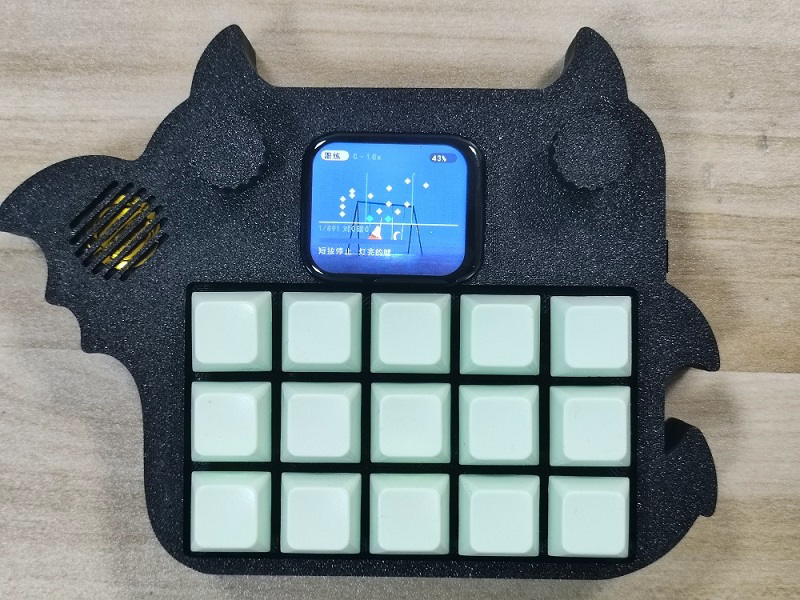

### 适合谁 / 不适合谁

| 适合 | 暂时不适合 |
|------|------------|
| 想用实体键练《光·遇》谱、少戳屏幕的玩家 | 指望「开箱即有完整手机 App」的用户（App 仍在做，本包不开源） |
| 喜欢可复刻开源硬件、愿意焊板/烧录的创客 | 完全零焊接、零烧录经验且不想学习的新手（有预编译，但仍需烧录与装配） |
| 想换音色、换背景、改固件的改造党 | 需要 88 键全音域真钢琴表现的用户（本机是 15 白键采样琴） |

---

## 02 · 核心亮点

相对「开发板 + 喇叭」或「纯 HID 键盘」，V2 想讲清楚的是这五件事：

#### 🎹 实体 15 键 = 游戏键位

K1–K15 对应 C4–C6 白键，与谱面 `1Key0`…`1Key14`、出厂 `1.wav`…`15.wav` **同一套编号**。摸到就能对上谱，不用重新学布局。

#### 💡 每键一灯，跟练落在手指上

15 路 RGB 不只是氛围灯：跟练时提示落在**要按的那颗键**上，弹错有指示。比小屏上「猜格子」直观得多。

#### 🔊 真采样，无卡也能响

出厂钢琴采样在 Flash 资源区（22050 Hz / 16-bit / mono，约 2.5 s）。**没有 TF 卡也能开箱演奏**；有卡再扩展自己的谱、歌和音色。

#### 📟 本机 UI，不绑手机

284×240 彩屏 + 旋钮：主页 / 菜单 / 音乐 / 曲谱等模式可在板上完成。手机 App **未完成、不开源**——但板端已经是一台能玩的琴。

#### 📡 BLE HID，进游戏直接弹

系统配对成键盘后，实体键可向兼容环境发送按键事件。App 不是游戏输入的必经之路。

---

## 03 · 拿起来能玩什么

| 场景 | 你会看到什么 |
|------|----------------|
| **开机即弹** | 上电 → 按键 → 钢琴声 + RGB。不登录、不配网。 |
| **晚上跟谱** | 旋钮进曲谱 / 跟练；灯提示目标键；错键有反馈。 |
| **进游戏演奏** | BLE HID 配对手机 / 电脑 → 实体键映射到游戏 15 音。 |
| **通勤听歌** | TF 放入支持的音频；板上播放（格式以固件实测为准）。 |
| **无卡演示** | 出厂演示谱 + 晴空 / 夜空背景，插电给人看一眼就懂。 |
| **改造成自己的琴** | 换 15 个 wav = 新音色；换 raw = 新皮肤；源码和镜像都在仓库。 |

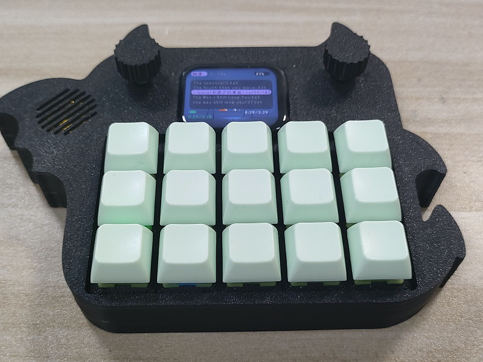

### 功能分镜

**实体按键与发声**  
15 键矩阵，板载采样经 PCM5102A → 功放 → 腔体喇叭。

**RGB 灯光**  
按键反馈 + 跟练提示，位置与物理键一一对应。

**彩屏与旋钮**  
主页、菜单、音乐、曲谱等界面围绕「当前要做什么」设计，而不是塞满设置项。

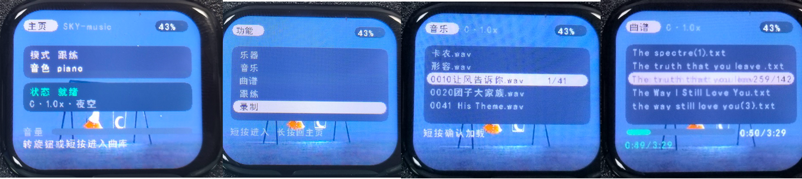

**曲谱跟练**  
选谱、跟练、按键错误指示。

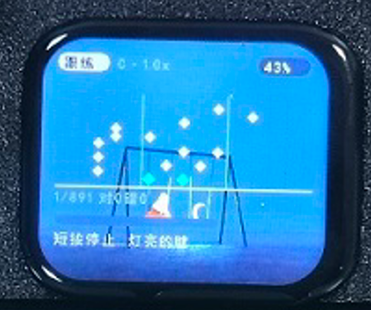

**BLE HID**  
配对后发送键盘事件；兼容性取决于系统、游戏与键位表。

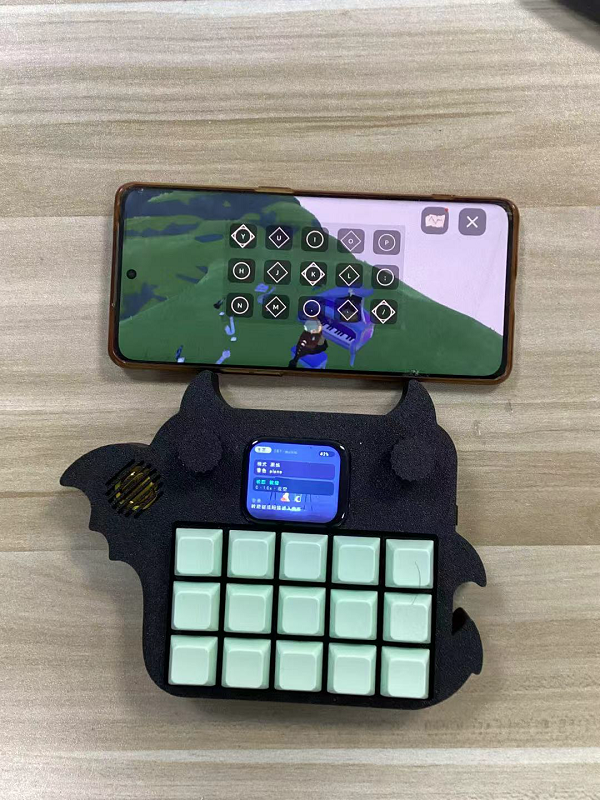

**TF 扩展**  
按约定目录放曲谱 / 音乐 / 音色；外部资源可覆盖出厂同名项（优先级见固件与 FAQ）。

---

## 04 · 产品规格

| 项目 | 规格 |
|------|------|
| 项目名称 | SKY-music V2 |
| 定位 | 开源便携 15 键采样琴 |
| 主控 | ESP32-S3（音频 / 屏 / RGB / TF / BLE） |
| 输入 MCU | CH32V003（矩阵扫键 / 旋钮 / I²C 从机） |
| 按键 | 15 有效键（4×4 矩阵） |
| 音域 | C4–C6，15 个白键 |
| 音频 | I²S → PCM5102A DAC → 板载功放 + 腔体喇叭 |
| 音源 | Flash 出厂钢琴采样；TF 可扩展 |
| 灯光 | 15× WS2812 类 RGB（每键一颗） |
| 显示 | 284×240 SPI 彩屏（可用带触摸模组，见配件说明） |
| 操作 | 实体键 + 旋钮 + 屏 |
| 无线 | BLE HID（游戏 / 主机键盘） |
| 存储 | 可选 TF；出厂资源在 `assets` 分区 |
| 供电 | Type-C / 带保护板锂电池（示例 3000 mAh） |
| 续航参考 | 约 3000 mAh 电池下 **> 4 h**（中等音量，实测口径请自行标注） |
| 固件工具 | CH32：MounRiver；ESP32：ESP-IDF 5.5 / 预编译 esptool |
| 当前版本 | 硬件 RevB · 固件 FW-1.2.0 · 发布包 V2.0.1 · 验证 2026-10-31 |

---

## 05 · 为什么是双 MCU

一台琴要同时做：**扫键、旋钮、混音、刷屏、灯效、读卡、蓝牙**。  
这些事的实时性不一样——键不能糊，音不能断，屏和无线又占调度。

所以 V2 把活拆开：

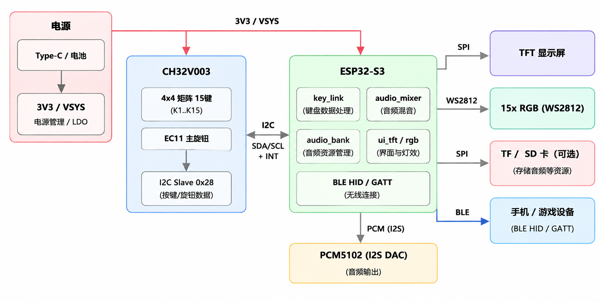

### CH32V003 · 输入协处理

- 4×4 矩阵扫描、EC11 旋钮、事件上报  
- I²C 从机地址 **0x28**，WHOAMI 期望 **0xCB**  
- 可单独用 WCH-Link 点亮、验键，不必等整板软件齐  

### ESP32-S3 · 声音与交互

- 采样播放 / 音源管理、UI、RGB、TF、BLE HID  
- 经 I²C + INT 接收按键与旋钮事件  

### 通信与音频细节

协议与寄存器：`docs/protocol/kb_regs.h`、`docs/BRINGUP.md`、`docs/HW_V2.md`。  
音频链路：ESP32-S3 → PCM5102A → 功放；上电静音与 unmute 顺序做过处理，减轻开机爆破音。

> 对复刻者：先确认 CH32 WHOAMI，再烧 ESP；双 MCU 出问题，优先分侧排查。

---

## 06 · 硬件设计与结构

设计取舍可以概括成四句：

1. **紧凑：** 键、灯、屏、旋钮、DAC、功放、无线挤在便携尺寸里  
2. **分工：** 输入 MCU 与主控解耦，避免「大核顺便扫键」  
3. **独立音频：** I²S DAC + 功放，不是 GPIO 方波  
4. **可复刻：** Gerber / BOM / 外壳模型进仓库  

PCB 入壳：

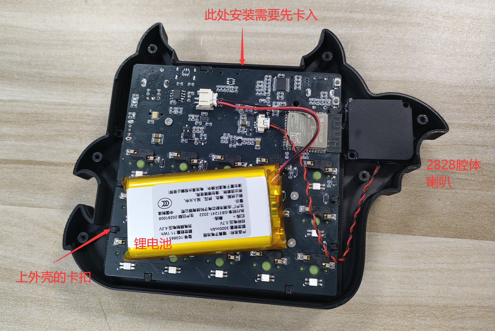

顶部接口：

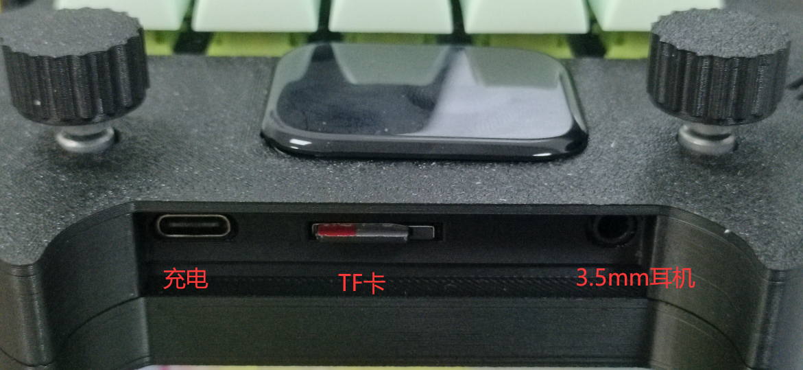

### 关键配件与平替（踩坑向）

1. **彩屏（可带触摸）**  
   参考：[淘宝链接](https://item.taobao.com/item.htm?id=1005324528530)  
   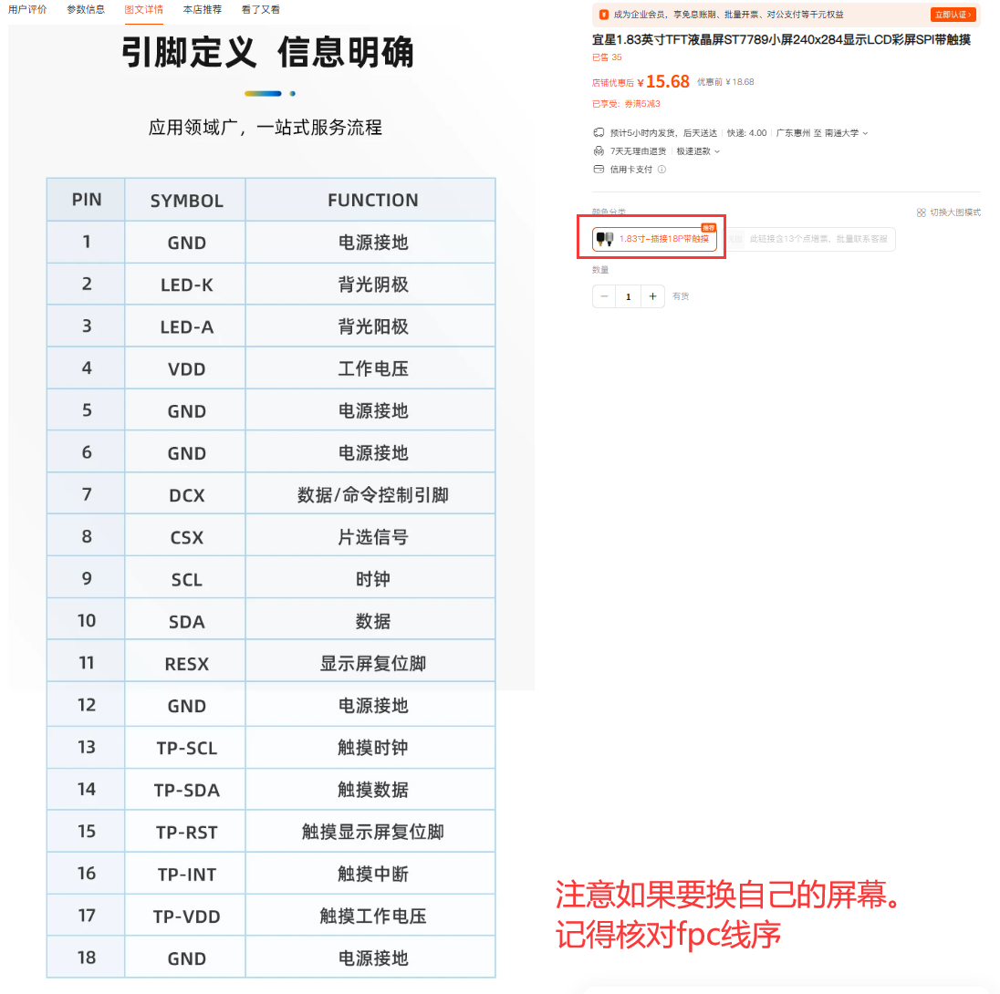  
   也可用其它喜欢的屏；需自行核对 FPC 线序与原理图。

2. **麦克风 ICS-43434**  
   可用钰太 **ZTS6672** 平替，价低，听感接近。

3. **锂电池务必带保护板**  
   示例：欣薇 103665 聚合物 3.7 V / 约 3000 mAh。换型号时核对接线端子与外壳腔体。

4. **C25 / C26 / C27 / C32 / C36（1206 MLCC）**  
   对成本敏感时可评估省略（以你实测电源与音频为准）。

5. **喇叭**  
   建议现成腔体喇叭 + 1.25 mm 端子，省得自己开腔。  
   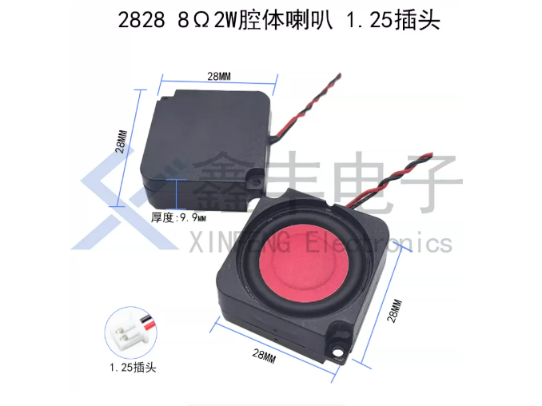

### 原理图

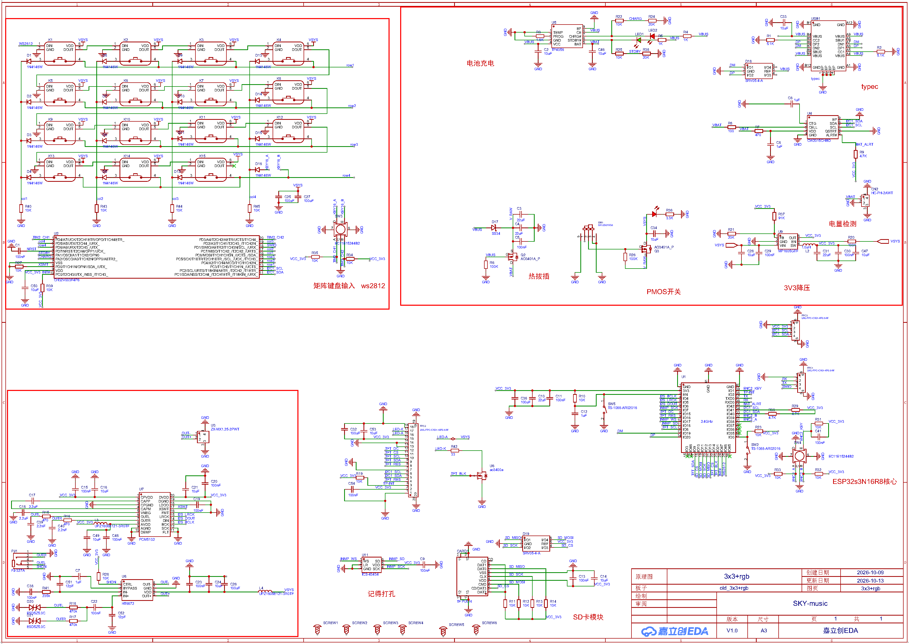

完整原理图 / PCB / Gerber / BOM → `hardware/`。

### 外壳（必读）

> ⚠️ **不要直接照抄「小恶魔」外形量产。**  
> 外壳外形曾用 DXF 导入，曲面线段极多，SolidWorks 直接打开可能极卡甚至崩溃。更稳妥的做法：从嘉立创专业版导出 PCB 的 STEP，按实板重做外壳。  
> 打样后开关位置有微调，旧模型请自行核对。

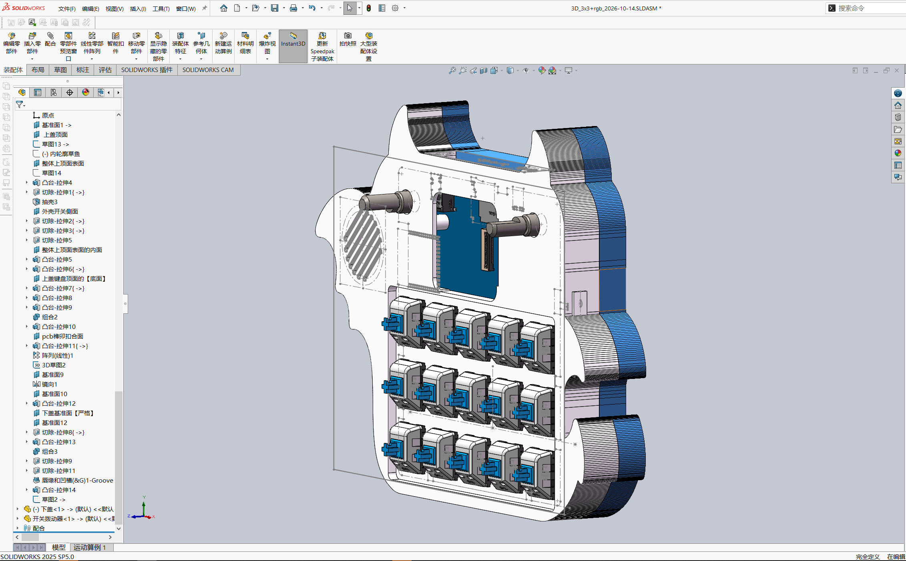

模型在 `enclosure/`。打印参数、螺丝、间隙建议另维护 `docs/ASSEMBLY.md`。

---

## 07 · 开源内容与目录

目标：从**打板 → 烧录 → 出声**一条链路资料齐全。

```text
SKY-music-V2/
├── README.md
├── LICENSES/  NOTICE
├── docs/          HW / BRINGUP / ASSEMBLY / protocol/kb_regs.h
├── hardware/      schematic · gerber · bom
├── enclosure/     STEP · STL · 3MF
├── assets/factory piano · ui · puzi
└── firmware/
    ├── ch32v003-keyboard/   自包含工程 + prebuilt/*.hex
    └── esp32s3/
        ├── flash/           预编译 bin + 烧录脚本
        └── source/          ESP-IDF 源码（需自备 IDF）
```

| 目录 | 用途 |
|------|------|
| `hardware/` | 原理图、Gerber、BOM |
| `enclosure/` | 外壳三维 |
| `firmware/ch32v003-keyboard/` | 输入固件 + HEX |
| `firmware/esp32s3/flash/` | 一键烧录镜像 |
| `firmware/esp32s3/source/` | 二次开发源码 |
| `assets/factory/` | 出厂钢琴 / 背景 / 演示谱 |
| `docs/` | 硬件、上电、协议 |
| `NOTICE` | 第三方署名 |

**本包不含手机 App 源码与安装包。** 板端协议公开，欢迎社区自写上位机。

---

## 08 · 快速开始（烧录）

面向已经焊好 / 拿到板的复刻者。

### 工具

| 工具 | 用途 |
|------|------|
| WCH-Link | CH32 下载；也可当 USB 串口烧 ESP |
| MounRiver Studio | 改 CH32 时编译 |
| Python + `esptool` | ESP 烧录 |
| ESP-IDF 5.5 | 改 ESP 源码时 |
| 数据线 | 供电 / 下载 |

> **调试座：** 板载烧录为 FPC，体积优先。  
> 最左 **CH32 SWIO** · 中 **ESP TX/RX** · 右 **GND**。  
> SWIO↔WCH-Link SWDIO，GND 共地；ESP 的 TX/RX 可用 Link 自带 USB-UART。  
> **烧录前打开板载开关，保证系统上电。**

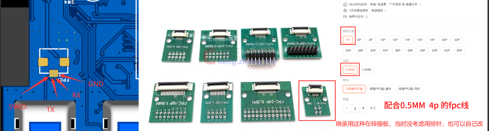

### ① 烧 CH32V003

1. 接 SWIO、GND（及按你链路需要的 3V3）  
2. 烧 `firmware/ch32v003-keyboard/prebuilt/ch32v003-keyboard.hex`  
3. 查 I²C `0x28`，WHOAMI → `0xCB`  

### ② 烧 ESP32-S3

```powershell
pip install esptool
cd firmware\esp32s3\flash
.\flash_all.ps1 COMx
```

或分开：

```powershell
.\flash_app.ps1 COMx
.\flash_assets.ps1 COMx
```

空片建议：**按住 BOOT → 复位/上电 → 松 BOOT → 再烧**。  
预编译默认 **16 MB N16R8**；`assets` 偏移见脚本 / `partitions.csv`（常见 `0x310000`）。

### ③ 首启检查

- [ ] 3V3 正常，板载开关有效  
- [ ] CH32 ↔ ESP 通信正常  
- [ ] 15 键事件正确  
- [ ] 旋钮可操作菜单  
- [ ] 出厂钢琴可发声  
- [ ] RGB 与按键一致  
- [ ] 屏幕显示正常  
- [ ] 出厂谱 / 背景可读  
- [ ] BLE HID 可配对发键  
- [ ] （可选）TF 覆盖行为符合预期  

---

## 09 · 固件开发与资源定制

### CH32

MounRiver 打开 `firmware/ch32v003-keyboard/`（已内嵌 EVT 子集，点开即编）。  
方向：扫键、旋钮、寄存器、事件队列。

### ESP32-S3

`firmware/esp32s3/source/` + ESP-IDF 5.5。  
首次建议只改 UI/资源加载，确认链路后再动音频与通信。  
`idf.py flash` **默认不烧 assets**；改音色后需 `assets-flash` 或脚本烧 `assets.bin`。

### 出厂钢琴

`assets/factory/piano/` · `1.wav`…`15.wav`  
22050 Hz / 16-bit / Mono / ~2.5 s / C4–C6 白键。

### 背景

`assets/factory/ui/` · `bg_sky.raw` / `bg_night.raw`  
284×240 · RGB565 LE。

### 曲谱

`assets/factory/puzi/`  
文件名建议 **ASCII**（打包工具短名限制）；展示名可写在 JSON `name`。

### 统一键位

| 键 | 谱 | 文件 | 音高 |
|----|----|------|------|
| K1–K7 | `1Key0`–`1Key6` | 1–7.wav | C4–B4 |
| K8–K14 | `1Key7`–`1Key13` | 8–14.wav | C5–B5 |
| K15 | `1Key14` | 15.wav | C6 |

---

## 10 · 常见问题 FAQ

优秀开源项目一半的「省心感」来自 FAQ。下面按复刻顺序写——**有问题先搜本节**。

### 复刻前

**Q1. 资料从哪下？**  
A. 硬件在立创工程 / `hardware/`；固件在 `firmware/`；外壳在 `enclosure/`；说明就是本文 + `docs/`。

**Q2. 一定要会 ESP-IDF 吗？**  
A. 不必。预编译 + `esptool` / 脚本即可出声。改功能再装 IDF 5.5。

**Q3. 手机 App 呢？**  
A. **未完成，不开源。** 板上可独立演奏与 HID；协议在 `docs/`，可自写上位机。

**Q4. 和《光·遇》官方有关系吗？**  
A. **没有。** 仅为键位习惯兼容的独立开源项目。

### 焊接与装配

**Q5. 调试座怎么接线？**  
A. FPC：左 SWIO、中 TX/RX、右 GND。详见快速开始。

**Q6. 外壳直接打印仓库文件？**  
A. **谨慎。** DXF 导入曲面很碎，CAD 易卡；开关位置有改版。建议按 PCB STEP 重做或至少核对。

**Q7. 电池怎么选？**  
A. **必须带保护板**；核对接线与外壳尺寸。

### 烧录与调试

**Q8. ESP 识别不到串口？**  
A. 用数据线；开板上电；BOOT+复位进下载；换口/驱动。

**Q9. 有画面没声音？**  
A. 查 CH32 是否已烧、I²C WHOAMI、DAC unmute（XSMT）、功放与喇叭端子、assets 是否烧入。

**Q10. 键乱跳 / 串键？**  
A. 先验 CH32 单独扫键；再查矩阵电阻、共地、固件版本是否匹配硬件 Rev。

**Q11. 换了 wav 没变化？**  
A. 是否烧了新 `assets.bin`？TF 同名是否覆盖了出厂？格式是否为 22050/16/mono？

**Q12. BLE 连上游戏没反应？**  
A. 查系统是否认成键盘、游戏键位表、当前 map、是否被其它 HID 占用。

### 资源与定制

**Q13. 曲谱文件名能用中文吗？**  
A. 出厂打包工具对非 ASCII 文件名不友好，**建议 ASCII 文件名**，曲名放内容字段。

**Q14. N8（8MB）能用这份预编译吗？**  
A. 预编译按 **16MB N16R8**。N8 请换分区表并自行编译。

---

## 11 · 复刻成本与打板注意

| 项目 | 参考 |
|------|------|
| PCB 单板（参考） | 约 ¥4 / 块（视活动与工艺） |
| 整机复刻 | 约 **¥125** |
| 成本口径 | 电池、双 MCU、15 轴体、显示屏、阻容与主要器件等；**不含**你的工时、特殊表面处理、运费溢价 |

建议发布前用自己的采购单再核一版，并在立创页填写「复刻成本」。

| 交付物 | 位置 |
|--------|------|
| 立创工程 | 〔填写链接〕 |
| BOM | `hardware/bom/` |
| Gerber | `hardware/gerber/` |
| 外壳 | `enclosure/` |
| 固件 | `firmware/` |

**打板提示（请按你的实板补全）：** 层数、板厚、阻焊颜色、是否沉金、最小孔径等写清楚，能显著减少「打错板」的评论区。

---

## 12 · 开源协议与声明

| 内容 | 许可证 |
|------|--------|
| 原理图 / PCB / 外壳 | CERN-OHL-P-2.0（以 `LICENSES/` 与立创勾选为准） |
| 自研固件与烧录脚本 | MIT |
| 文档 | CC BY 4.0 |
| 钢琴采样等第三方 | 见 **NOTICE**（多为 CC BY，不可笼统写成 MIT） |
| WCH EVT 等 | 原厂许可 |

第三方署名、采样来源、字体与参考工程一律进 `NOTICE`。

### 版本与已知限制

- 发布包 **V2.0.1** · 硬件 **RevB** · 固件 **FW-1.2.0** · 验证 **2026-10-31**  
- 预编译面向 16MB Flash；资源镜像与固件版本需匹配  
- TF 格式 / 文件名 / 目录优先级以实测为准  
- BLE 效果依赖主机与游戏配置  
- 制造以仓库发布的硬件版本为准  

### 参与改进

欢迎：输入与音频调度、谱与灯效、资源管理、PCB/外壳工艺、文档与复现用例。  
提 Issue 请带：**硬件版本、固件版本、复现步骤、日志**。

### 致谢

感谢开源硬件与工具链作者、采样与谱面贡献者。  
SKY-music V2 与《光·遇》及其发行商**无官方隶属或授权关系**。

---

**把 15 个音符做成实体，把一台能弹的琴做成可以复刻的开源工程。**

📺 演示 〔链接〕 · 🔧 立创 〔链接〕 · 💻 仓库 〔链接〕 · 💬 交流 〔选填〕
